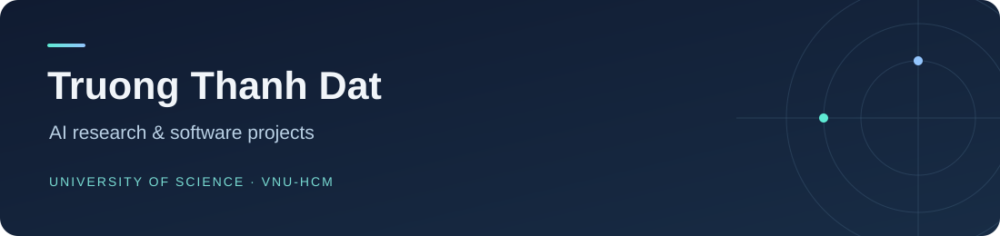

  

  <a href="#research">Research</a> &nbsp;·&nbsp;
  <a href="#retrieval">Retrieval</a> &nbsp;·&nbsp;
  <a href="#applications">Applications</a> &nbsp;·&nbsp;
  <a href="#coursework">Coursework</a>

I'm **Truong Thanh Dat**, an undergraduate at the Faculty of Information Technology, University of Science, VNU-HCM.

My public projects explore speech recognition, machine translation, computer vision, and information retrieval, alongside web applications and C++ coursework.

**Tools across these projects:** Python · PyTorch · Hugging Face Transformers · React · JavaScript · C++

## AI & research

| Project | Focus |
| :--- | :--- |
| **[PhonoRepair](https://github.com/Thanhdat3010/PhonoRepair)** | Research on intermediate representation repair for frozen speech recognition models and pathological speech. |
| **[TSSA](https://github.com/Thanhdat3010/TSSA)** | Target-side semantic anchoring for low-resource neural machine translation. |
| **[LongAttention](https://github.com/Thanhdat3010/Long_attention)** | Gated long-range attention experiments for document-level machine translation. |
| **[CSP](https://github.com/Thanhdat3010/CSP)** | A context-synchronized data augmentation pipeline for camouflaged object detection. |

## Retrieval & challenges

| Project | Focus |
| :--- | :--- |
| **[V-GATE · AIC2026](https://github.com/Thanhdat3010/AIC2026)** | Multimodal video retrieval, question answering, and temporal event search for AI Challenge HCMC 2026. |
| **[Bau RAG](https://github.com/Thanhdat3010/bau-rag)** | Python backend API for a retrieval-augmented generation application. |

## Web applications

| Project | Focus |
| :--- | :--- |
| **[TayVinSchool](https://github.com/Thanhdat3010/TayVinSchool)** | A Tay language dictionary and learning application with flashcards and video components. |
| **[Nam Ky Cultural Project](https://github.com/Thanhdat3010/namky-cultural-project)** | A React website exploring Southern Vietnamese culture and Saigon imagery. |
| **[Portfolio](https://github.com/Thanhdat3010/portfolio)** | A personal portfolio website built with React, based on an existing portfolio template. |

## Coursework

| Project | Focus |
| :--- | :--- |
| **[Crossing Game](https://github.com/Thanhdat3010/CrossingGame)** | An SAO-inspired road-crossing game built with C++ and SDL3 for object-oriented programming coursework. |
| **[Study Assistant](https://github.com/Thanhdat3010/lab01-Thanhdat3010)** | A Python study-assistant starter project for CSC10014 coursework. |

---

Explore a project above for its code, documentation, and experiment details.

